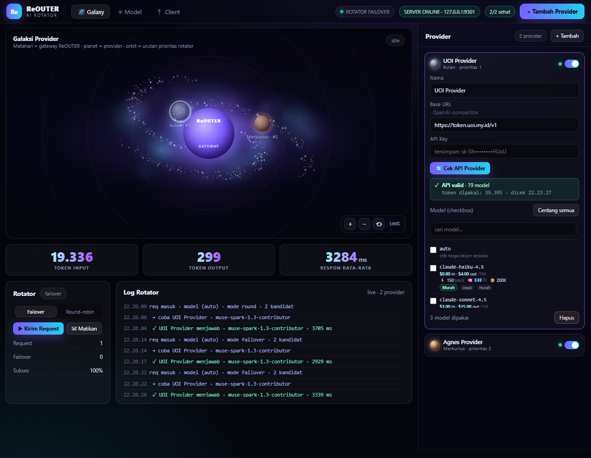

# ReOUTER — Local AI Gateway

> Satu endpoint OpenAI-compatible (`http://127.0.0.1:9301/v1`) untuk semua provider AI.
> Model mati? Yang terbaik & tercepat langsung ambil alih. Dashboard: **http://127.0.0.1:9301**

## Cara pakai (3 langkah)

1. `npm install` lalu `npm start` (atau double-click `ReOUTER.vbs`).
2. Buka `http://127.0.0.1:9301` → menu **Provider & API Key** → tempel API key → **Cek & Tambahkan**.
   Provider terdeteksi otomatis (OpenAI, Anthropic, Gemini, Groq, OpenRouter, DeepSeek, TokenRouter, UOI, dan OpenAI-compatible lainnya).
3. Buka menu **Koneksikan CLI**, copy config ke OpenCode / Claude Code / Cline / Aider. Selesai.

## Yang bekerja otomatis

- **Pemilihan AI terbaik (mode Auto)** — skor = kualitas model 40% + kecepatan nyata 40% + keandalan 12% + prioritas 8%. Model lemot & gampang salah turun sendiri.
- **Failover** — provider error, key ditolak, kuota habis, atau timeout → request langsung diteruskan ke provider berikutnya tanpa putus.
- **Load balance** — tiga kandidat teratas dipakai bergiliran supaya tidak menumpuk di satu provider.
- **Model terkuat dipakai dulu** — tanpa permintaan model spesifik, tiap provider menyumbang model paling pintar yang dicentang.
- **Cek API** — tombol cek membaca daftar model nyata + mengukur latensi, lalu mengaktifkan 2 model terbaik secara otomatis.

## Dashboard

Dashboard memakai **SB Admin 2** (Start Bootstrap, MIT) dan seluruh asetnya ada di `public/vendor/` — jalan tanpa internet:

| Menu | Isi |
| --- | --- |
| Dashboard | status provider, AI yang dipakai, urutan pengambilalihan, grafik siapa menjawab, log live |
| Provider & API Key | tambah provider (deteksi otomatis / manual), pilih model, cek ulang, jeda & pulihkan |
| Model Aktif | semua model yang boleh dipakai beserta kualitas, kecepatan, harga |
| Peringkat AI | skor otomatis dan alasan peringkatnya |
| Koneksikan CLI | endpoint + contoh config siap copy |

ReOUTER adalah aplikasi **local AI gateway** ber-tema gelap modern. Satu endpoint OpenAI-compatible lokal (`http://127.0.0.1:9301/v1`) yang otomatis memilih dan mengrotasi antar banyak provider AI — kalau provider mati, token habis, atau key ditolak, langsung **failover** ke provider lain **tanpa harus ganti model**.

## Fitur

- 📊 **Dashboard gelap** — kartu statistik, grafik sparkline & donut, tabel request terbaru.
- 🔌 **Setup provider** — paste API key + **Cek API Provider**, daftar model muncul dengan checkbox.
  - Search box untuk mencari model cepat.
- 🔄 **Tiga mode** — **Auto** (skor terbaik otomatis), **Rotasi** (giliran 3 model teratas), **Manual** (kamu yang pilih).
- 🧾 **Log Live** — timeline request / success / fail dengan provider & latensi.
- 🧪 **Test request** — tombol kirim request di dashboard.
- 🖥️ **Launcher** — `ReOUTER.vbs` + `reouter.ico` + `run.bat` → double-click buka browser langsung ke app.

## Cara Pakai

1. `npm install` di folder `reouter/`.
2. `node server/index.js` (atau `npm start`).
3. Buka `http://127.0.0.1:9301/`.
4. Tambahkan provider → paste API key → model terdeteksi otomatis.
5. Centang model yang boleh dipakai.
6. Arahkan CLI/kode kamu ke `http://127.0.0.1:9301/v1` — selesai.

## Arsitektur

```
reouter/
├── public/             # UI dashboard (tema gelap)
├── server/
│   ├── index.js       # Express server + gateway /v1, /anthropic, /api
│   ├── rotator.js     # Failover engine + event log + stats kumulatif
│   ├── providers.js   # Adapters OpenAI / Anthropic / Gemini + classifyError
│   ├── modelinfo.js   # Tabel harga / kecepatan / kapabilitas model
│   └── config.js      # Persistensi config (data/config.json)
├── run.bat            # Launcher
├── ReOUTER.vbs        # Silent launcher (.vbs)
└── reouter.ico        # Icon desktop
```

## Endpoints

| Endpoint | Fungsi |
|---|---|
| `GET /api/state` | State semua provider + events + stats |
| `POST /api/providers` | Tambah provider |
| `PATCH /api/providers/:id` | Update (apiKey, picked, enabled, ...) |
| `DELETE /api/providers/:id` | Hapus provider |
| `POST /api/providers/:id/check` | Cek API → daftar model |
| `POST /api/test` | Kirim test request lewat ReOUTER |
| `GET /api/stats` | Statistik kumulatif |
| `GET /v1/chat/completions` | OpenAI-compatible gateway |
| `GET /anthropic/v1/messages` | Anthropic-compatible gateway |
| `GET /health` | Health check |

## Screenshot



---

© ReOUTER — built for local AI failover.
